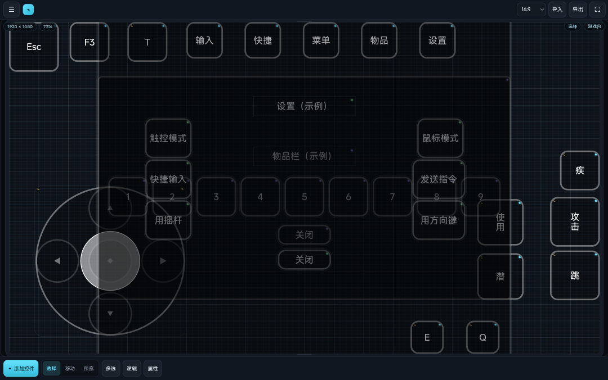
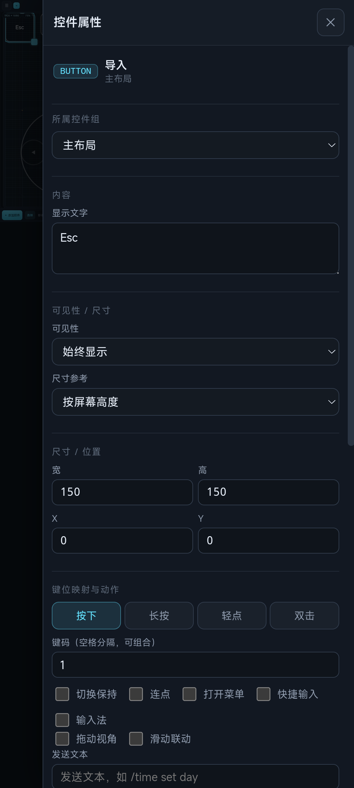
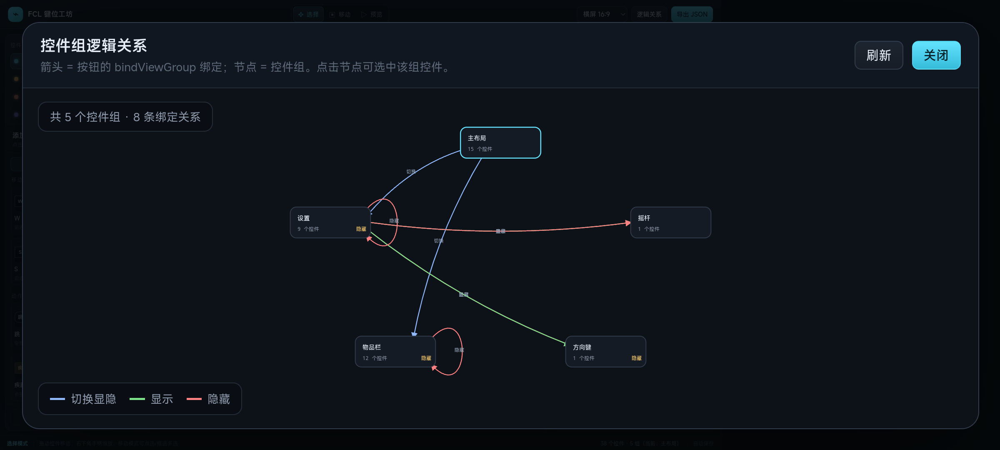

# FCL 键位工坊 · 手机横屏版

在手机横屏上可视化编辑 FCL 启动器键位（控制器）的网页工具。数据模型与 FCL 的
`controllerVersion 21` 键位 JSON 对齐，可导入/导出可直接使用的控制器文件。







## 快速开始

```bash
cd web
python3 dev_server.py 8899        # 开发用 no-cache 静态服务器
# 手机/浏览器打开 http://<电脑IP>:8899/
```

- **手机端最推荐直接用单文件版**：`dist/fcl-key-workbench.html`（HTML/CSS/JS/示例数据全部内联，
  一次请求、可直接双击打开），比逐文件加载模块快很多。
- 源码版（`index.html` + `js/*.js`）需要静态服务器，首次加载会发起多个模块请求，慢网络下较慢。
- 生产环境请给静态资源加缓存头（开发用的 `dev_server.py` 故意关闭了缓存）。
- 重新构建单文件版：

```bash
cd web
npm install --no-save esbuild   # 或已有 esbuild 时跳过
node build.mjs
```

## 部署到 GitHub Pages

这是一个**纯静态**应用，不需要后端，可以直接部署到 GitHub Pages。
项目里所有资源都用相对路径，放在 `https://<user>.github.io/<repo>/` 这种子路径下也能正常工作。

### 方式 A：直接上传源码（最简单，两分钟）

1. 新建 GitHub 仓库；
2. 把 **`web/` 目录里的全部内容**上传到仓库根目录（`index.html`、`css/`、`js/`、`data/`、`dist/` 等）；
3. 仓库 **Settings → Pages → Build and deployment**：Source 选 `Deploy from a branch`，
   Branch 选 `main`，目录选 `/ (root)`，保存；
4. 等一两分钟，访问 `https://<user>.github.io/<repo>/` 即为源码版；
   访问 `https://<user>.github.io/<repo>/dist/` 即为单文件版（手机推荐，加载更快）。

> 也可以把 `web/` 的内容放到仓库的 `/docs` 目录，然后在 Pages 里选择 `/docs`，效果相同。

### 方式 B：只上传单文件版（加载最快）

1. 本地执行 `cd web && npm install --no-save esbuild && node build.mjs`；
2. 把 `web/dist/` 里的 **`index.html`** 和 **`.nojekyll`** 上传到仓库根目录；
3. Pages 选择 `main / (root)`，访问仓库根地址即可。
   `index.html` 是内联 CSS/JS/示例数据的单文件，没有模块请求，手机打开最快。

### 方式 C：GitHub Actions 自动构建

仓库根目录 = `web/` 的内容时，项目已带 `.github/workflows/pages.yml`：

1. 上传 `web/` 全部内容（包含 `.github/`）；
2. **Settings → Pages → Source** 选 `GitHub Actions`；
3. 之后每次 push `main`，Actions 会自动构建单文件版并发布到 Pages。

> 如果你的仓库根目录是包含 `web/` 子目录的项目根，把 workflow 移到仓库根 `.github/workflows/`，
> 并在 build 步骤加 `working-directory: web` 即可。

### 注意事项

- 页面通过 HTTPS 提供，全屏按钮、localStorage、文件导入都正常；
- localStorage 按域名隔离，`github.io` 上的数据和本地 `localhost` 不互通；
- 手机端建议直接访问单文件版（`/dist/` 或方式 B 的根地址），源码版会发起多个模块请求，弱网下首屏较慢；
- 首次部署后如果改了代码，源码版注意强刷；单文件版重新构建上传即可。

## 界面与操作（手机端逻辑）

### 布局
- 顶部栏：**☰ 全局菜单**（文件/界面/帮助）、**撤回**、画布分辨率、导入、导出、全屏编辑。
- ☰ 与左下「＋添加控件」分工：☰ 是全局菜单（布局设置、排序、逻辑、导入导出、分类管理、帮助等），
  「添加控件」只负责打开添加控件/控件组面板。
- 中间画布：占满屏幕；信息浮层显示分辨率/缩放/模式/游戏状态。
- 底部栏：＋添加控件、选择/移动/预览、多选、游戏内/游戏外、逻辑、属性。
- 左抽屉：控件组（可收起）+ 自定义预设（分类 Tab + 详细属性）+ 导入控件。
- 右抽屉：属性编辑（键位映射、样式、绑定、尺寸位置等）。
- 全屏：顶栏 ⛶ 或按 F，隐藏所有栏画布铺满；底部浮动栏可切模式/退出。

### 滚动保持
- 在左侧控件组/预设列表点击控件组、切换开关、编辑属性时，列表**保持原滚动位置**，不会回弹到顶部；
  右侧属性面板在编辑时也会保留滚动位置，切换选中控件时才回到顶部；弹窗内列表同样保持滚动。

### 触摸交互
| 操作 | 效果 |
| --- | --- |
| 点控件 | 选中；「移动」模式或「多选」开启时逐个多点选 |
| 拖动控件 | 移动（多选时整体移动） |
| 拖右下角手柄 | 连续缩放控件 |
| **长按空白约 0.36s 后拖动** | 呼出框选，多选控件 |
| 双指 | 缩放 + 平移画布 |
| 单指拖空白 | 平移画布 |
| 双击控件 | 打开属性抽屉并聚焦文字输入 |

### 控件组
- 新建 / 重命名 / 删除；**每组带一个显示开关**，直接控制该组控件是否显示。
- **只有开关打开的组才会渲染到画布上**；关闭后该组控件从画布消失（不再显示半透明灰色幽灵），
  需要编辑时重新打开开关即可。
- 组面板可**收起/展开**；当前组高亮；双击组名选中该组全部控件；新控件加入当前组。
- **控件组排序**：组面板「排序」按钮，用 ↑↓ 调整顺序；影响列表、画布叠加顺序和导出 `viewGroups` 顺序。
- 新建的控件组默认可见。导出写入 `viewGroups` 的 `VISIBLE/INVISIBLE`。

### 添加控件 / 导入
- 添加区**只保留自定义预设**（内置示例控件已移除）。
- 自定义预设支持**分类 Tab**：全部 / 各分类；点「＋」新建分类。
- **删除分类**：每个自定义分类标签右侧有「✕」可直接删除（二次确认）；点「⚙」打开分类管理可批量重命名/删除；
  长按分类标签或右键也能打开管理。默认分类不可删除，其预设删除分类时会移入「默认」。
- 预设列表会显示详细属性：分类、类型、触发方式、键位、动作开关、绑定数量、尺寸、颜色等。
- 顶部「导入」/左抽屉「导入控件」可导入整个 FCL 控制器 JSON。

### 键位映射（FCL 风格选择器）
- 属性抽屉里键码不再是数字输入，而是**点击弹出键位选择界面**（常用/字母/数字符号/功能键/小键盘/鼠标），
  按点击顺序组成组合键，可清空、增删；方向控件四个方向各自选择。
- 同一个分页里可设置触发方式（按下/长按/轻点/双击）、动作开关（切换保持、连点、打开菜单、快捷输入、
  输入法、拖动视角、滑动联动、发送文本）和**绑定控件组**（切换/显示/隐藏）。

### 样式编辑
- 填充/描边/文字颜色与透明度、圆角、描边宽度、文字大小；方向控件可改背景/摇杆颜色与摇杆帽大小。

### 撤回
- 顶部「↶ 撤回」可撤销上一步操作（支持多步历史，最多 40 步），涵盖添加/删除/复制/对齐、
  拖动缩放、样式/键位/动作修改、控件组与分类操作、逻辑图节点位置与关系修改、导入/清空等。

### 预览
- 底部「游戏内 / 游戏外」切换，检查「仅游戏内」「仅游戏外」控件的显示。
- 预览中点按钮会模拟按键；**绑定到控件组的按钮会实际切换组显隐**。

### 逻辑关系图（可编辑 + 可拖动）
- 底部「逻辑」打开：节点 = 控件组，箭头 = 按钮 `bindViewGroup` 绑定。
- **拖动节点**调整布局（会保存）；点击节点选中该组控件；「重置布局」恢复自动排布。
- 点击箭头可**编辑关系**：切换/显示/隐藏、删除该关系；顶部「＋ 添加关系」可选择来源组、
  来源按钮、目标组、触发时机和动作，直接把绑定加到按钮事件上。

### 画布与导出
- 分辨率：16:9 / 19.5:9 / 20:9 / 自定义分辨率（宽高 px）。
- 导出 FCL JSON：按控件组导出 `viewGroups`，保留绑定关系；可直接放 `FCL/control/<id>.json`。
- 自动保存到 localStorage。

### 自检
- `?selftest=1` 跑 **68 项**浏览器内交互自检（触摸/缩放/长按框选/多选、键位选择器与弹窗叠层、
  分类 Tab、撤回、控件组开关与显隐、组排序、全局菜单、滚动保持、逻辑图拖动、预览显隐、导出、存储等）。

## 性能相关（本轮选择性优化）

- 单文件构建版：一次请求加载全部资源，手机端建议使用。
- 构建时压缩 CSS（约省 30% 样式体积），JS 使用 esbuild 压缩。
- 示例键位数据改为**页面内 JSON 懒解析**（不在启动时作为 JS 对象解析）。
- 增加启动加载屏，避免白屏等待焦虑。
- 减少渲染次数：选中/拖动等高频操作不再重建下拉面板，撤销快照不触发全量 UI 重绘。
- 拖拽/框选/缩放已经是「不重建 DOM、只更新样式 + rAF 合并」，避免卡顿。
- 开发服务器关闭缓存；生产环境请开启缓存（首次加载后模块可直接命中缓存）。

## 文件结构

```
web/
├── index.html          手机端页面骨架
├── css/app.css         深色工具风 + 手机横屏布局 + 抽屉/全屏/逻辑图/键位选择器
├── js/
│   ├── data.js         常量、键码表/分组、样式模板、默认分类
│   ├── store.js        状态、选中、控件组、预设分类、撤回历史、持久化
│   ├── stage.js        触摸手势、画布渲染、预览显隐/绑定执行
│   ├── ui.js           顶栏/底栏/抽屉/属性编辑/键位选择/分类/逻辑图/弹窗
│   ├── export.js       FCL JSON 导出/导入
│   ├── selftest.js     页面内自检（开发用）
│   └── main.js         入口与装配
├── data/demo0001.json  示例键位
├── dev_server.py       no-cache 开发服务器
├── build.mjs           单文件构建脚本
├── dist/               单文件构建产物
├── docs/               截图
└── README.md
```

## 已知边界

1. 逻辑图节点位置按布局保存；节点连线本身不可直接拖出（用「添加关系」创建）。
2. 事件编辑以「主触发分页 + 键码/开关」为主；暂未做组合键录制/宏。
3. 导入会替换整个画布，暂不支持“追加导入”。
4. 撤销为快照式，连续拖动会按一次操作计；文本输入按一次编辑记录。

## 与 FCL 的关系

键位格式与制作方法见 `../docs/FCL键位制作方法.md`；
导出 JSON 可用 `../tools/validate_controller.py` 校验。
